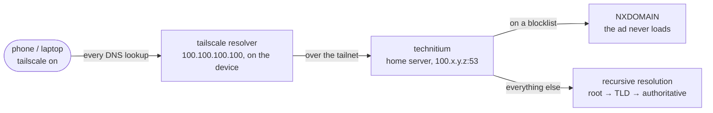

## tl;dr

i run [Technitium DNS Server](https://technitium.com/dns/) on a mini PC at home. it blocks ads, trackers, malware, and phishing domains (about 1.8 million of them) for every device on my tailnet, at home and on cellular, because [Tailscale](https://tailscale.com) sends each device's DNS lookups to it. this post walks through the whole setup: install, lock down, blocklists, Tailscale, and how to prove it actually works. i hit a handful of gotchas along the way that cost me real time, and each one is called out where it happens.

## why bother

in October 2026, Citizen Lab published [AdFection](https://citizenlab.ca/research/how-discover-tech-turned-targeted-ads-into-a-pipeline-for-spyware/): the first public confirmation of zero-click mercenary spyware delivered through targeted ads. nobody had to click anything. rendering the ad was enough. their advice for individuals includes: "Consider using an ad-blocking service on your network, such as at your home router".

that's what DNS-level blocking is. every app asks a DNS server for an address before it connects anywhere. if the resolver says the ad server doesn't exist, the ad code never loads, whether it's in a browser or inside an app. browser extensions can't touch in-app ads. DNS can.

it's not magic, though:

- ads served from the same domain as the content (YouTube, for example) can't be separated at the DNS level.
- apps and browsers that use their own DNS-over-HTTPS skip your resolver entirely.
- DNS only sees domain names, never what's inside an HTTPS connection.

HaGeZi's README puts it well: DNS blockers "can also block most ads, malware, scams, and fake sites, but they can't catch everything since some of that stuff doesn't work through DNS."

## the setup



the pieces:

- **Technitium DNS Server** (v15.6.2 at the time of writing) on Ubuntu 24.04. it resolves recursively by itself, so no upstream like Cloudflare or Google sees your lookups, and it validates DNSSEC.
- **blocklists** that refresh every day.
- **ufw**, so that only my LAN and my tailnet can reach it.
- **Tailscale** with a DNS override, so every device in the tailnet uses it wherever it is.

## 1. install

Technitium ships an install script. their docs pipe it straight into `sudo bash`. i'd rather read it first:

```bash
curl -fsSLo technitium-install.sh https://download.technitium.com/dns/install.sh
less technitium-install.sh
sudo sh technitium-install.sh
```

here's what the v15 script does:

- installs the ASP.NET Core 10 runtime into `/opt/dotnet` with Microsoft's `dotnet-install.sh`, and links `/usr/bin/dotnet` to it if nothing is there yet.
- unpacks the server into `/opt/technitium/dns`. your configuration lives in `/etc/dns`.
- on a **fresh** install only: creates a `dns-server` system user, installs `dns.service`, **stops and disables `systemd-resolved`**, and rewrites `/etc/resolv.conf` to `nameserver 127.0.0.1`. from then on, the box itself resolves through Technitium.

the web console is at `http://<server>:5380`.

**note**: the `systemd-resolved` change surprises people. Ubuntu's stub resolver listens on port 53, and Technitium needs that port. if anything on the box relied on `systemd-resolved`, it doesn't anymore.

### updating

re-run the same script. on an existing install it only downloads the new version, updates the .NET runtime, resets file ownership, and restarts the service. your configuration in `/etc/dns` stays. to see which version you're on:

```bash
grep -o '"DnsServerApp/[0-9.]*"' /opt/technitium/dns/DnsServerApp.deps.json
```

apt doesn't manage the runtime in `/opt/dotnet`, so `apt upgrade` never patches it. re-running the installer is how that gets updated too.

stay current. [CVE-2026-45557](https://nvd.nist.gov/vuln/detail/cve-2026-45557) let anyone who controls a domain make versions before 15.0 generate excessive network traffic by chasing missing DNSSEC records. v15.0 fixed it, along with several other vulnerabilities.

## 2. run it as a locked-down user

this one is easy to miss. v15 ships a systemd unit that runs the server as an unprivileged `dns-server` user, with heavy sandboxing. here's an excerpt:

```ini
[Service]
User=dns-server
Group=dns-server
ReadWritePaths=/etc/dns /var/log/technitium/dns
NoNewPrivileges=true
ProtectSystem=strict
ProtectHome=true
PrivateTmp=true
AmbientCapabilities=CAP_NET_BIND_SERVICE
CapabilityBoundingSet=CAP_NET_BIND_SERVICE
UMask=0077
```

a DNS server parses packets from untrusted clients all day long. if it ever gets exploited, this unit leaves the attacker with a user that can only write to `/etc/dns`, its log folder, and a private `/tmp`. it holds exactly one capability, `CAP_NET_BIND_SERVICE`, which it needs to bind port 53.

the catch: **fresh installs get this unit, in-place updates don't.** the update path never creates the user and never replaces `/etc/systemd/system/dns.service`. my server was installed before v15, and after the update to v15 it was still running as root. check yours:

```bash
ps -o user= -C dotnet
```

if that says `root`, switch to the unit that ships inside the package:

```bash
sudo useradd --system -M --shell /usr/sbin/nologin --user-group dns-server
sudo mkdir -p /var/log/technitium/dns
sudo chown -R dns-server:dns-server /opt/technitium/dns /etc/dns /var/log/technitium/dns
sudo cp /etc/systemd/system/dns.service /etc/systemd/system/dns.service.root-backup
sudo cp /opt/technitium/dns/systemd.service /etc/systemd/system/dns.service
sudo systemctl daemon-reload
sudo systemctl restart dns
```

then make sure it runs as the new user and still answers:

```bash
ps -o user= -C dotnet               # dns-server
dig +short @127.0.0.1 example.com   # an IP address
```

if it doesn't come back up, copy the backup over `/etc/systemd/system/dns.service`, run `daemon-reload`, and restart. once it works, delete the backup.

**note**: `UMask=0077` makes every file the server writes from now on readable only by `dns-server`. from here on, reading the logs or the query database needs `sudo`.

## 3. firewall it

by default, Technitium listens on two ports: 53 for DNS (UDP and TCP) and 5380 for the web console (plain HTTP). allow both from your LAN and from Tailscale, and nothing else. this assumes `ufw` with its default `deny (incoming)` policy. if `ufw` isn't enabled yet, allow your SSH port first, then run `sudo ufw enable`, or you'll lock yourself out:

```bash
LAN=192.168.1.0/24   # replace with your LAN subnet
sudo ufw allow from $LAN to any port 53 proto udp
sudo ufw allow from $LAN to any port 53 proto tcp
sudo ufw allow from $LAN to any port 5380 proto tcp
sudo ufw allow in on tailscale0 to any port 53
sudo ufw allow in on tailscale0 to any port 5380 proto tcp
sudo ufw status
```

never forward port 53 or 5380 on your router. open resolvers on the internet get found and abused for DDoS amplification, and the web console controls where every one of your devices goes.

**note**: this only works because Technitium runs directly on the host. if you run it in Docker with published ports, Docker writes its own iptables rules that skip `ufw` entirely.

## 4. the admin password

the first login is `admin` / `admin`, and the console asks you to change it. do it right away, and put the new one in a password manager.

### if you forget it

i did. the reset is to move the auth file aside while the server is stopped:

```bash
sudo systemctl stop dns
sudo mv /etc/dns/auth.config /etc/dns/auth.config.old
sudo systemctl start dns
```

order matters. the server writes `auth.config` when it shuts down, so moving the file while it runs does nothing.

after the restart, `admin` / `admin` works again, from your whole LAN and tailnet. close that window right away, from the server itself (needs `jq`):

```bash
read -rsp 'new admin password: ' NEW; echo
TOKEN=$(curl -s --data-urlencode user=admin --data-urlencode pass=admin \
  http://127.0.0.1:5380/api/user/login | jq -r .token)
curl -s --data-urlencode token="$TOKEN" --data-urlencode pass=admin \
  --data-urlencode newPass="$NEW" http://127.0.0.1:5380/api/user/changePassword
```

`--data-urlencode` sends the values in a POST body, so the passwords stay out of the URL.

**gotcha**: v15 changed this endpoint. older docs and forum answers send the *new* password as `pass`. v15 wants the current password in `pass` and the new one in `newPass`. the old call fails with `Parameter 'newPass' missing.`, and the default login stays open while you figure that out. ask me how i know.

the reset also wipes all users, sessions, and API tokens. once you're back in, delete the old file with `sudo rm /etc/dns/auth.config.old`.

## 5. blocklists

more lists isn't better. every list costs memory and adds false positives (broken logins, broken shopping links), and the big curated lists already merge most of the small ones. two lists do the heavy lifting:

- **OISD Big**: ads, trackers, and malware, curated to keep false positives low.

  `https://big.oisd.nl/domainswild2`

- **HaGeZi Threat Intelligence Feeds**: malware, phishing, scams, and command-and-control domains, updated at least daily.

  `https://raw.githubusercontent.com/hagezi/dns-blocklists/main/wildcard/tif-onlydomains.txt`

both URLs use the *wildcard domains* format, which is the one HaGeZi's README lists for Technitium. one entry covers a domain and all of its subdomains, so the files stay smaller for the same coverage.

add them under **Settings → Blocking → Block List URLs**, one URL per line, then save. Technitium downloads them and refreshes them every day. with about 1.8 million blocked domains loaded, mine uses about 600 MB of RAM.

**gotcha**: don't paste a list URL on the **Blocked** page. that page takes single domains, and you'll get `Invalid domain name [...]: invalid character [58] was found.`. character 58 is `:`.

### dead lists fail quietly

plenty of older guides recommend abuse.ch's URLhaus and ThreatFox host files. abuse.ch retired both download URLs, which now return `410 Gone`. Technitium doesn't stop or warn you loudly. it keeps using the last good copy and writes this to its log every day:

```text
DNS Server failed to download block list and will use previously downloaded file (if available): https://urlhaus.abuse.ch/downloads/hostfile/
```

mine had been stale for almost a month before i noticed. check yours once in a while:

```bash
sudo grep -h "failed to download block list" /etc/dns/logs/*.log /var/log/technitium/dns/*.log 2>/dev/null | tail
```

**note**: the downloaded lists live in `/etc/dns/blocklists`, and each file is named after the SHA-256 of its URL. `printf %s "$URL" | sha256sum` tells you which file belongs to which list, and the file date tells you when it last changed.

### when something breaks

add the domain under **Allowed**. don't drop a whole list for one false positive.

## 6. send every device to it with Tailscale

if your router lets you set the DNS server that DHCP hands out, point it at the server and your home network is covered. Tailscale covers everything else: a phone on cellular, a laptop on hotel Wi-Fi.

on the server, join the tailnet without taking Tailscale's DNS settings. the server is the resolver, so it shouldn't route its own lookups back through the tailnet to itself:

```bash
sudo tailscale up --accept-dns=false
tailscale ip -4   # the server's tailnet address, 100.x.y.z
```

then, in the Tailscale admin console:

1. **Machines** → your server → **Disable key expiry**. otherwise it drops off the tailnet after 180 days.
2. **DNS** → **Nameservers** → **Add nameserver** → **Custom**, and enter the server's `100.x.y.z` address. leave **Restrict to domain (Split DNS)** off. with it on, only the domains you list go to the server.
3. turn on **Override DNS servers** (older consoles call it **Override local DNS**). without it, devices keep their own DNS and only fall back to yours.

Technitium's default recursion setting, **Allow Recursion Only For Private Networks**, already answered my tailnet devices, so i left it alone. if yours get `REFUSED`, that's the setting to look at.

### the gotcha that cost me the most time

my tailnet already listed Cloudflare (`1.1.1.1`, `1.0.0.1`, and their two IPv6 addresses) as global nameservers. Tailscale uses them in preference order, and Cloudflare sat above my server. it answered every lookup, and Technitium got **zero** lookups from my phone, while everything looked like it worked.

check what your devices actually receive. `tailscale dns status --all` on any node prints it:

```text
Resolvers (in preference order):
  - 100.x.y.z
```

your server has to be the only entry. a public resolver as a "backup" defeats the point: it wins the race, and nothing gets blocked.

the trade-off: the server is now a single point of failure. if it's down, devices with Tailscale on can't resolve anything. turn Tailscale off on that device until the server is back.

## 7. prove it works

don't test this by opening an ad domain in your phone's browser. that's what i did first: `pagead2.googlesyndication.com` didn't load, so i called it done. ad servers often have no page to load either way, so that test proves nothing.

test at the DNS level instead. from a laptop on the tailnet (`100.100.100.100` is the Tailscale resolver that runs on the device itself):

```bash
dig +short @100.100.100.100 example.com                          # an IP address
dig @100.100.100.100 pagead2.googlesyndication.com | grep status   # NXDOMAIN
```

then confirm on the server that the lookups actually arrived, and from which device. install **Query Logs (Sqlite)** from **Apps → App Store** in the console. you can browse the logs under **Logs**, or summarize them per client from a shell (`sudo apt install sqlite3` if you don't have it):

```bash
sudo sqlite3 "/etc/dns/apps/Query Logs (Sqlite)/querylogs.db" \
  "select client_ip, count(*), sum(rcode = 3) from dns_logs
   where timestamp >= datetime('now', '-15 minutes')
   group by client_ip order by 2 desc;"
```

each tailnet device shows up by its `100.x` address. with **Blocking Type** set to **NX Domain**, blocked lookups come back with `rcode = 3`, so the last column counts blocks (plus names that genuinely don't exist). once i'd removed Cloudflare, my phone showed 124 lookups and 12 blocks in its first 15 minutes.

you can also pretend to be a tailnet client from the server itself, by binding `dig` to the server's tailnet address:

```bash
dig @100.x.y.z -b 100.x.y.z example.com | grep status   # NOERROR
```

## 8. the phone

two things on iOS:

- leave Tailscale on. that's the whole client setup.
- go to **Settings → Privacy & Security → Tracking**, and turn off **Allow Apps to Request to Track**. apps then get a zeroed advertising ID, which is one of the identifiers that AdFection-style ad targeting relies on.

## maintenance

- **every month or so**: re-run the installer. it updates Technitium and its .NET runtime, and the hardened unit stays in place.
- **now and then**: grep the logs for failed list downloads.
- **when a site breaks**: allowlist the domain.

that's it: one box, two lists, one Tailscale setting, and every device i own stops loading ads and known-bad domains, wherever it is.
